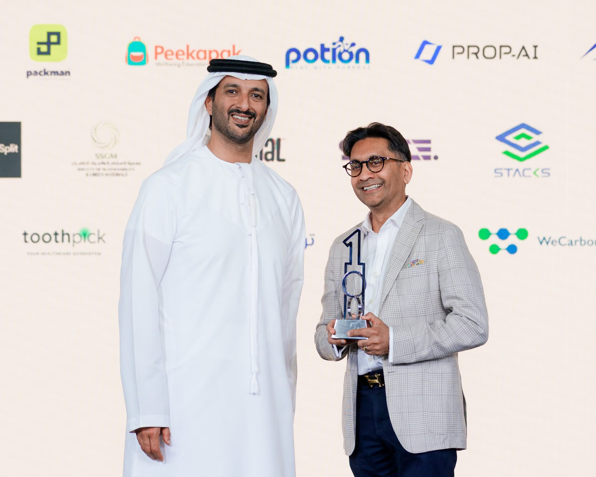
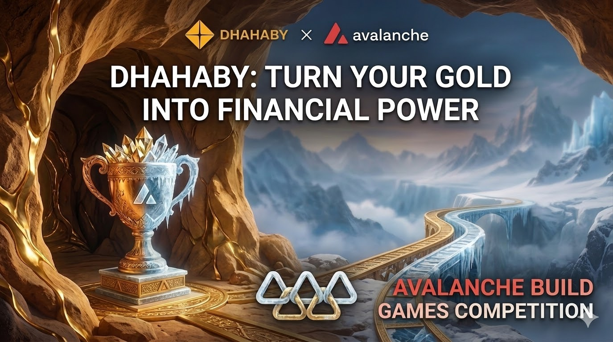
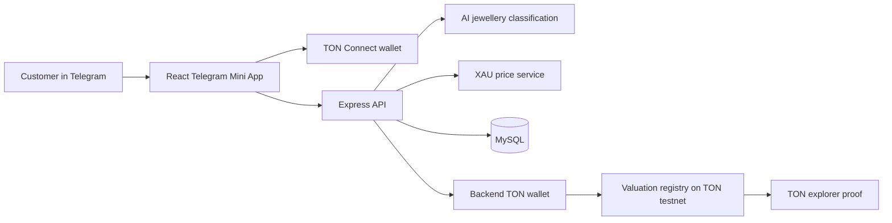

<div align="center">
  <p>
    <a href="https://dhahaby.com"></a>
  </p>
  <h1>
    <a href="https://dhahaby.com">
      
    </a>
  </h1>
  <p><strong>Making dormant household gold work like money.</strong></p>
  <p><em>Modern finance for timeless assets.</em> Tokenise once. Borrow, spend or sell.</p>
  <p>
    
    
    
    
  </p>
  <p>
    <a href="https://dhahaby.com">Website</a> ·
    <a href="https://hub.dhahaby.com/?page=ai_valuation">Value my gold</a> ·
    <a href="https://www.youtube.com/watch?v=oa8Z7aCov-k&t=78s">Watch the video</a> ·
    <a href="https://mena.entrepreneur.com/entrepreneurs/future-100-2025-winner-dhahaby">Future 100 feature</a> ·
    <a href="https://blog.dhahaby.com/">Blog</a>
  </p>
</div>

<div align="center">
  
  <br />
  <sub>Dr. Rikin Patel, Founder &amp; CEO, receives Dhahaby's <strong>UAE Future 100</strong> award from H.E. Abdulla Bin Touq, UAE Minister of Economy &amp; Tourism, at Investopia.</sub>
</div>

---

## At a glance

<table>
  <tr>
    <td><strong>Market</strong><br />$500B+ of gold dormant in GCC homes alone</td>
    <td><strong>Regulation</strong><br />Regulatory pathways with two central banks (UAE · Qatar)</td>
    <td><strong>Ecosystem</strong><br />Two lenders signed · jeweller network live (UAE · Qatar)</td>
    <td><strong>Demand</strong><br />$3.5M institutional enquiry · 65+ transaction-specific enquiries</td>
  </tr>
  <tr>
    <td><strong>Recognition</strong><br />🇦🇪 UAE Future 100 Company</td>
    <td><strong>Prizes &amp; grants</strong><br />TON SuperApp winner ($15K) · Uzbek IT Park Finclusion winner ($10K) · Avalanche Build Games finalist ($10K grant)</td>
    <td><strong>Backed by</strong><br />Antler · Qatar Development Bank</td>
    <td><strong>Organic pull</strong><br />4,800+ visitors · 415+ waitlist · zero paid marketing</td>
  </tr>
</table>

> **We are raising our next round.** If you invest in fintech, real-world assets or GCC infrastructure, we'd like to talk: [ceo@dhahaby.com](mailto:ceo@dhahaby.com) · [LinkedIn](https://www.linkedin.com/company/dhahabyofficial/)

---

## Watch: Dhahaby in two minutes

<div align="center">
  <a href="https://www.youtube.com/watch?v=oa8Z7aCov-k&t=78s">
    
  </a>
  <br />
  <sub>▶ <a href="https://www.youtube.com/watch?v=oa8Z7aCov-k&t=78s">Dhahaby: Make Your Gold Work Like Money | Borrow, Spend, Sell or Store Your Gold</a></sub>
</div>

---

## The problem

**More than $500B of gold sits dormant in GCC homes alone.** It is real wealth, but it doesn't work. Banks don't lend against it because three things are missing:

| Missing rail | Why it blocks lending |
|---|---|
| **Trusted valuation** | A lender can't underwrite an item whose weight, purity and value nobody has verified. |
| **Secure custody** | Collateral has to be held somewhere the lender can rely on. |
| **Reliable liquidation** | If a loan defaults, the lender needs a dependable way to sell the gold at market. |

No rails means no lending. Households are pushed to informal liquidity that costs **30–80% APR**, or they sell heirlooms outright.

---

## The solution: tokenise once, then borrow, spend or sell

1. **AI valuation.** An instant estimate based on the live gold price.
2. **Jeweller verification.** A certified jeweller confirms the item in person.
3. **Auto-tokenisation.** We automatically mint the verified gold into on-chain collateral.

Verified physical gold becomes **reusable, programmable collateral**. You verify it once and can put it to work again and again.

| Borrow | Spend | Sell |
|---|---|---|
| **Gold-backed loan.** Instant credit while you keep ownership of your gold. | **Mastercard on Gold.** A credit limit that moves with your collateral. | **Liquidate at market.** A wholesale bid, settled through our jewellers. |

**How we earn:** a 2% loan-execution fee, 70% of card interchange, and margins on valuation and custody.

Dhahaby is the technology platform. Lending is provided by licensed partners.

---

## Traction and moat: we built the moat first, the code second

| Regulation | Ecosystem | Demand |
|---|---|---|
| **Two central banks.** Regulatory pathways established in the UAE and Qatar. | **Two lenders signed.** Jeweller network live in the UAE and Qatar. | **$3.5M institutional enquiry.** 65+ transaction-specific enquiries. 4,800+ visitors and a 415+ waitlist, with zero paid marketing. |

AI valuation, on-chain collateral and regulator buy-in are all in place. **Now we execute.**

---

## The journey so far

Most recent first: recognised by the UAE government as one of the companies shaping the nation's future economy, taken multi-chain on Avalanche, and first proven on TON.

### Latest: a 🇦🇪 UAE Future 100 company

Dhahaby was recognised as a **UAE Future 100** company, which means the UAE Government sees it as an innovative company shaping the nation's future economy. We received the award from **H.E. Abdulla Bin Touq, UAE Minister of Economy & Tourism, at Investopia**.

At the ceremony, H.E. said he had personally reviewed every company recognised, and that when he travels abroad he is proud to talk about the businesses being built here.

For a company building gold-backed finance in one of the world's great gold markets, that recognition matters. It signals alignment with the UAE's economic agenda as we scale partnerships with financial institutions, payment networks and jewellers across the GCC.

> *"There is still a huge amount to build. But moments like this fuel our fire, and remind us what is possible in a country that genuinely wants its entrepreneurs to succeed."*
> — Dhahaby

📰 Read the feature: [Future 100 2025 Winner: Dhahaby, Entrepreneur Middle East](https://mena.entrepreneur.com/entrepreneurs/future-100-2025-winner-dhahaby)

### Before that: multi-chain on Avalanche, a Build Games finalist with a $10K grant

Building on the TON prototype, we took the same valuation and collateral flow onto the **Avalanche C-Chain** and turned the prototype into an operational platform with three roles: customer, appraiser and admin. Dhahaby was a **finalist in the Avalanche Build Games** competition and received a **$10K grant**.

What the Avalanche build added beyond the TON prototype:

- **EVM rails.** Valuation proofs are written to Avalanche C-Chain (Fuji) through Ethers v6, and wallets connect with Reown AppKit.
- **The full appraisal loop.** Customers book jeweller appraisals, appraisers review bookings, and admins decide which assets are converted into collateral.
- **Auto-tokenisation.** Converted assets enter a queue, and a retry-safe worker mints them as AVAX NFTs, so each verified item gets an on-chain collateral record.
- **Production-grade surfaces.** Appraiser and admin consoles are protected by Firebase authentication.

The Avalanche codebase lives in a private repository, **[DHAHABY-COM/Dhahaby-HUB-AVAX](https://github.com/DHAHABY-COM/Dhahaby-HUB-AVAX)**. Investors and partners can request access at [ceo@dhahaby.com](mailto:ceo@dhahaby.com).

<div align="center">
  
  <br />
  <sub>Finalist, Avalanche Build Games, with a $10K grant.</sub>
</div>

### Where it started: winning the TON SuperApp Challenge

Dhahaby's first rail was built in this repository: a **Telegram Mini App on TON** where a customer photographs a gold item, receives an AI pre-valuation, connects a TON wallet and creates a verifiable on-chain valuation record.

It won the **TON Foundation × Ignyte "Build the Web3 SuperApp" challenge** from the global *Chain the Future* program, together with its **$15K first prize**.

<div align="center">
  
  <br />
  <sub>Winner, TON Foundation × Ignyte "Build the Web3 SuperApp" challenge: $15K.</sub>
</div>

### All recognition

| Program | Result |
|---|---|
| 🇦🇪 UAE Future 100 | **Future 100 Company**, recognised by the UAE Government |
| Avalanche Build Games | **Finalist** ($10K grant) |
| TON Foundation × Ignyte "Build the Web3 SuperApp" | **Winner** ($15K prize) |
| Uzbek IT Park Finclusion Challenge | **Winner** ($10K prize) |
| ADIB Digital Assets Innovation | **Runner-up** |

---

## Why this team wins

<table>
  <tr>
    <td width="50%">
      <strong><a href="https://www.linkedin.com/in/drrikinpatel/">Dr. Rikin Patel</a></strong><br />
      <em>Founder &amp; CEO</em> · <a href="https://www.linkedin.com/in/drrikinpatel/">LinkedIn</a><br /><br />
      Former Head of MENA Equities at JPMorgan and UBS, with 25+ years in finance, 14 of them in the GCC. His previous fintech exited to AJ Bell plc in 2021.
    </td>
    <td width="50%">
      <strong><a href="https://www.linkedin.com/in/huankaichen/">Dr. Huankai Chen</a></strong><br />
      <em>Co-Founder &amp; CTO</em> · <a href="https://www.linkedin.com/in/huankaichen/">LinkedIn</a><br /><br />
      PhD in Computer Science and MSc in Actuarial Science. Serial founder with 400+ citations and deep expertise in valuation, credit and AI.
    </td>
  </tr>
</table>

**Institutional finance meets applied AI. Few teams have both.**

---

## Beyond gold: every dormant asset class

Gold is the wedge into the world's largest dormant asset class: **the household balance sheet**. The same rails of valuation, verification, custody and on-chain collateral extend to **diamonds, watches, luxury goods, art and other real-world assets** as every asset class moves on-chain.

The collateral layer is chain-agnostic. We shipped on TON for consumer distribution inside Telegram, and on Avalanche for EVM-compatible DeFi and institutional rails.

---

## About this repository: the TON prototype

This repository is the **TON Foundation challenge-winning prototype**, kept as the first chapter of the Dhahaby story. It is a Telegram Mini App where the user photographs gold, receives an AI pre-valuation, connects a TON wallet and records the valuation on TON testnet.



| | TON prototype (this repo) | Avalanche build (private) |
|---|---|---|
| **Distribution** | Telegram Mini App | Web app (customer, appraiser, admin) |
| **Wallet** | TON Connect | Reown AppKit |
| **Chain** | TON testnet | Avalanche C-Chain (Fuji) |
| **On-chain output** | Valuation record | Valuation record + collateral NFT issuance |
| **Stack** | React 19, Vite 7, Express 5, MySQL, `@ton/ton` | React 19, Vite 7, Express, MySQL, Ethers v6, Firebase |
| **Workflow coverage** | Valuation → on-chain proof → asset history | Valuation → appraisal booking → review → conversion → mint |

<details>
<summary><strong>Run the TON prototype locally</strong></summary>

<br />

The repository contains two Node projects: the Vite frontend at the root and the Express backend in `server/`.

**Prerequisites:** Node.js 18+, MySQL, a Telegram bot/Mini App configuration, a funded TON testnet wallet, TON Center and AI service credentials, and a deployed valuation contract.

```bash
# frontend
npm install

# backend
cd server
npm install
cp .env.example .env   # fill in MySQL, OPENAI_API_KEY, TON_* and CONTRACT_ADDRESS
node index.js
```

Then start the frontend from the repository root with `npm run dev`. You can inspect the UI in a browser, but the full Telegram context requires launching the app through Telegram.

> Never use a mainnet mnemonic for local development. Keep `.env` out of version control.

```text
public/                          TON Connect manifest, logo
src/App.jsx                      Telegram shell, TON wallet, navigation
src/components/UploadSection.jsx Image capture, AI valuation, TON submission
src/components/LoansSection.jsx  Wallet asset history and explorer links
server/index.js                  Express API and orchestration
server/components/tonClient.js   TON wallet, message and confirmation logic
src/docs/                        Challenge brief and event photography
```

</details>

**Prototype boundaries:** AI output is a pre-valuation, not a certified appraisal. An on-chain record proves that data was submitted, but it doesn't prove the physical item is authentic. Lending requires licensed partners, identity checks, appraisal and custody, which the production platform provides through its partners.

---

## About Dhahaby

Dhahaby was founded in 2025 at the DIFC Innovation Hub in Dubai by [Dr. Rikin Patel](https://www.linkedin.com/in/drrikinpatel/) and [Dr. Huankai Chen](https://www.linkedin.com/in/huankaichen/), and is backed by Antler and Qatar Development Bank. We are building the financial infrastructure that makes dormant household gold work like money.

<div align="center">
  <p><strong>Built in the UAE 🇦🇪, for a market where gold really matters. Made to export globally.</strong></p>
  <p><strong>We are raising our next round.</strong> <a href="mailto:ceo@dhahaby.com">Get in touch</a>.</p>
  <p>
    <a href="https://dhahaby.com">Website</a> ·
    <a href="https://www.linkedin.com/company/dhahabyofficial/">LinkedIn</a> ·
    <a href="https://www.instagram.com/dhahabyofficial/">Instagram</a> ·
    <a href="https://x.com/dhahabyofficial">X</a> ·
    <a href="https://www.youtube.com/@dhahabyofficial">YouTube</a>
  </p>
  <sub>Dhahaby is a technology platform and does not itself lend, take deposits or hold custody. Financial products are provided by licensed partners. Figures are indicative.</sub>
</div>
