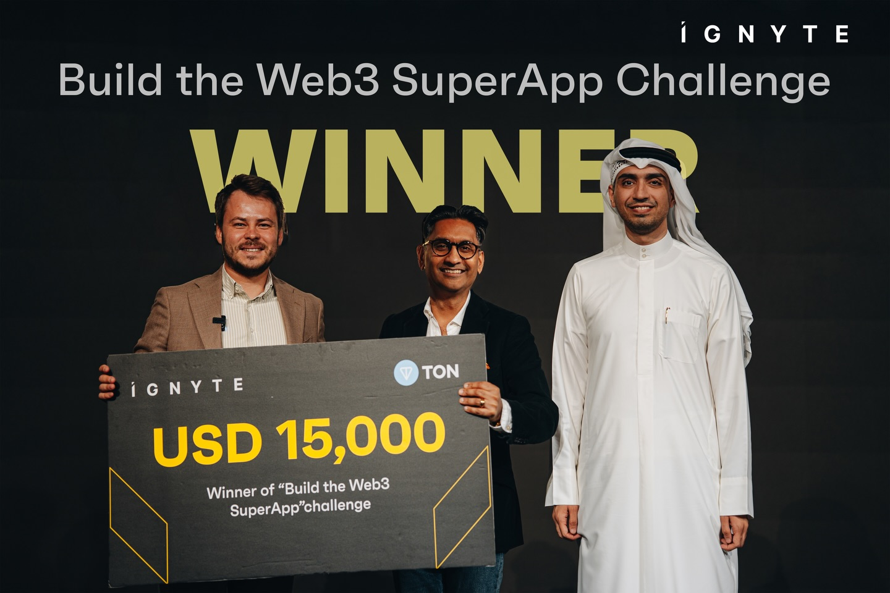
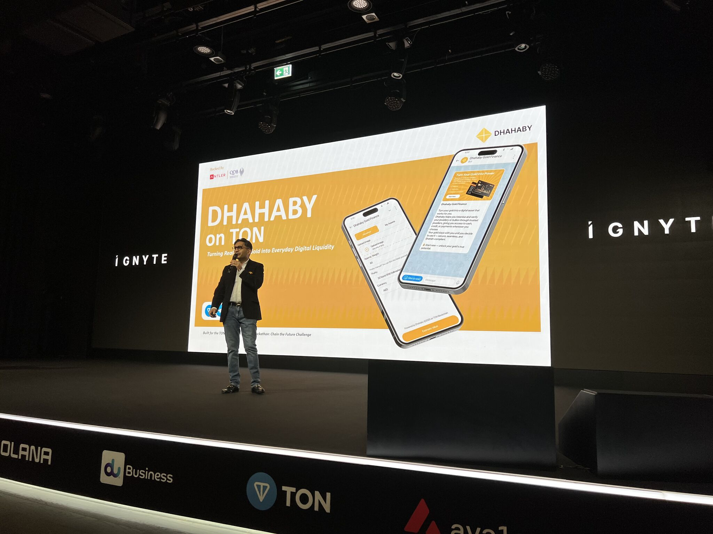
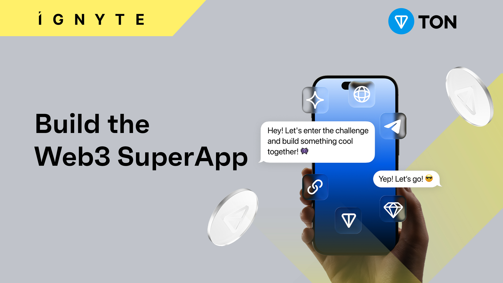
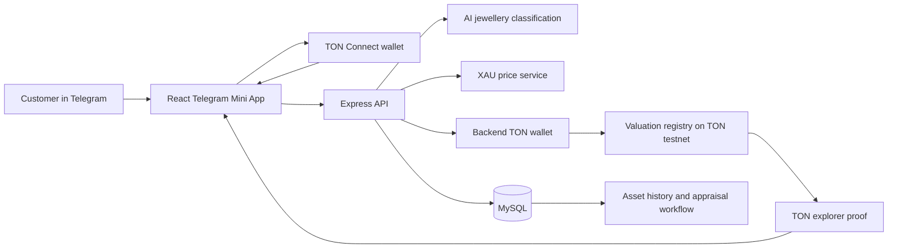

<div align="center">
  <p>
    
  </p>
  <h1>Dhahaby on TON</h1>
  <p><strong>Turning real-world gold into verifiable digital value, inside Telegram.</strong></p>
  <p>
    <a href="https://dhahaby.com">Dhahaby Official Website</a> |
    <a href="https://avax.dhahaby.com/">Dhahaby HUB</a> |
    <a href="https://blog.dhahaby.com/">Dhahaby Blog</a>
  </p>  
<p>
    
    
    
    
  </p>
  <p>
    Winner of the <strong>TON Foundation × Ignyte “Build the Web3 SuperApp” challenge</strong><br />
    from the global <em>Chain the Future</em> program.
  </p>
  <p>
    <a href="#the-story">The Story</a> ·
    <a href="#the-product">The Product</a> ·
    <a href="#why-ton--telegram">Why TON</a> ·
    <a href="#technical-architecture">Architecture</a> ·
    <a href="#run-it-locally">Run Locally</a>
  </p>
</div>

<div align="center">
  
</div>

---

## At a glance

<table>
  <tr>
    <td><strong>Achievement</strong><br />Challenge winner</td>
    <td><strong>Prize</strong><br />USD 15,000</td>
    <td><strong>Chain</strong><br />TON Testnet</td>
    <td><strong>Distribution</strong><br />Telegram Mini App</td>
  </tr>
  <tr>
    <td><strong>Track</strong><br />Tokenization</td>
    <td><strong>Asset</strong><br />Physical gold and jewellery</td>
    <td><strong>Core UX</strong><br />AI valuation + TON Connect</td>
    <td><strong>Prototype</strong><br />Full-stack, testnet-backed</td>
  </tr>
</table>

> Gold has stored value for thousands of years. Dhahaby asked a more modern question: what if the gold already sitting in a family’s home could become understandable, verifiable, and financially useful without forcing that family to sell it?

---

## The story

Across the GCC and other gold-rich markets, people often hold meaningful wealth in jewellery. The value is real, but it is difficult to use. A lender cannot act on a photograph. A customer may not know the weight, purity, or fair value of an item. Physical appraisal takes time, and each new financial conversation starts from zero.

Dhahaby was built to close that gap.

The prototype begins where users already are: **inside Telegram**. A customer photographs a gold item, receives an AI-assisted pre-valuation, connects a TON wallet, and creates a durable digital record that can be followed by physical verification and financing through licensed partners.

The idea was not to put gold “on-chain” as a slogan. It was to make the journey from an object in someone’s hand to a trusted financial record feel natural enough for everyday use.

That story won the TON Foundation × Ignyte challenge and its **USD 15,000 first prize**.

<div align="center">
  
  <br />
  <sub>Dhahaby on stage: “Turning Real World Gold into Everyday Digital Liquidity.”</sub>
</div>

---

## The problem

Gold can be liquid in theory and inaccessible in practice.

- **Owners lack a trusted first estimate.** Purity, weight, market price, and condition all affect value.
- **Lenders lack a reusable digital trail.** A claim about an item is not the same as a verifiable record.
- **Appraisal is fragmented.** Discovery, valuation, jeweller verification, and finance often happen in separate systems.
- **Crypto onboarding adds friction.** Asking mainstream users to install unfamiliar tools breaks the journey before it begins.

Dhahaby connects those fragmented steps into one path: discover the value, record the evidence, verify the asset, and unlock a regulated financial next step.

---

## The product

### From jewellery to a reusable financial record

1. **Open Dhahaby in Telegram**<br />
   The Mini App reads the Telegram user context and adapts to the user’s Telegram theme.

2. **Photograph the gold item**<br />
   The customer uploads an image and supplies the item details needed for a pre-valuation.

3. **Receive an AI-assisted estimate**<br />
   The backend classifies the item and returns estimated purity, weight, confidence, reasoning, variance, and value using a current XAU price reference.

4. **Connect a TON wallet**<br />
   TON Connect provides the wallet session without pulling the customer out of the experience.

5. **Create the digital valuation record**<br />
   The backend stores the pre-valuation and submits its valuation data to the TON testnet contract flow.

6. **Verify and continue**<br />
   The customer can see the asset history, open the TON explorer record, and move toward jeweller verification and gold-backed financing.

```text
Physical gold
    ↓ photograph
AI-assisted pre-valuation
    ↓ connect identity
TON wallet + Telegram user
    ↓ create proof
TON testnet valuation record
    ↓ physical confirmation
Verified asset
    ↓ licensed partner
Loan, credit, or another financial use
```

### What the prototype demonstrates

<table>
  <tr>
    <td><strong>Telegram-native onboarding</strong><br />Mini App identity, theme awareness, expansion, popup, and haptic APIs.</td>
    <td><strong>TON wallet connection</strong><br />TON Connect button, address state, wallet status events, and balance display.</td>
  </tr>
  <tr>
    <td><strong>AI pre-valuation</strong><br />Image classification, estimated purity and weight, confidence, variance, and valuation reasoning.</td>
    <td><strong>Live gold reference pricing</strong><br />Backend XAU pricing endpoint used to translate the assessment into a currency value.</td>
  </tr>
  <tr>
    <td><strong>TON testnet proof</strong><br />Valuation messages encoded into TON cells, sent to the registry flow, and confirmed by wallet sequence number.</td>
    <td><strong>Asset history</strong><br />Wallet-scoped pre-valuations with lifecycle status and TON explorer links.</td>
  </tr>
  <tr>
    <td><strong>Physical appraisal path</strong><br />A bridge from AI estimate to jeweller review and verified collateral.</td>
    <td><strong>Finance path</strong><br />A product foundation for gold-backed loans and credit through licensed partners.</td>
  </tr>
</table>

---

## Why TON + Telegram

The challenge asked builders to make Web3 payments and tokenization feel native to everyday life. TON and Telegram gave Dhahaby the right primitives for that goal.

### Distribution without a new destination

Telegram is not a landing page users must discover. It is already a daily communication layer. A Mini App can turn a message, referral, or partner conversation into a product session without an app-store detour.

### Wallet UX that stays in the journey

TON Connect makes wallet connection part of the interface instead of a separate technical ritual. In this prototype, the connected address becomes the link between the customer, pre-valuation history, and on-chain proof.

### A chain built for consumer-scale interactions

Dhahaby’s flow needs small, fast interactions rather than rare, high-value settlement alone. TON’s architecture and Telegram alignment make it a natural fit for repeated consumer actions, from recording valuations to future payments and tokenized financial products.

### Real-world assets need both worlds

The blockchain does not inspect gold. The AI estimate does not replace a certified appraiser. Dhahaby deliberately combines:

- **Off-chain intelligence** for image analysis, pricing, user records, and operational workflows.
- **Physical verification** for authenticity, purity, weight, and custody.
- **On-chain evidence** for a durable, inspectable valuation trail.

That hybrid model is the product: each layer does the job it is best equipped to do.

---

## Challenge fit

The TON Foundation × Ignyte program focused on business infrastructure, payments, and tokenization. Dhahaby entered through the real-world asset tokenization opportunity.

| Judging dimension | Dhahaby response |
|---|---|
| **Innovation** | Turns privately held gold into a digital valuation record that can progress toward verified collateral. |
| **TON & Telegram fit** | Uses Telegram Mini Apps for distribution and TON Connect plus TON testnet for the wallet and proof layer. |
| **Feasibility & execution** | Demonstrates a working frontend, backend, wallet connection, classification flow, database persistence, and testnet submission path. |
| **Market relevance** | Addresses the gap between household gold ownership and practical access to finance. |
| **Sustainability & scale** | Creates a repeatable rail for appraisal partners, lenders, and future gold-backed products. |
| **Storytelling** | Starts with an object people already trust and gives it a digital journey people can understand. |

<div align="center">
  
</div>

---

## Technical architecture

Dhahaby is a hybrid full-stack prototype. React renders the Telegram experience, TON Connect manages the customer wallet session, Express coordinates valuation and persistence, MySQL holds operational state, and a server-controlled TON wallet submits valuation records to testnet.



### Frontend

- **React 19 + Vite 7** for the Mini App UI and development workflow.
- **Telegram Web Apps SDK** for user context, theme integration, expansion, haptics, and native popups.
- **TON Connect UI React** for wallet connection and connection-state events.
- **TON SDKs** for address parsing, balance queries, cell construction, and transaction payloads.
- **Tailwind CSS 4** plus project CSS for the mobile-first interface.

### Backend

- **Node.js + Express 5** for user, classification, valuation, price, asset, booking, and tracking endpoints.
- **MySQL** for Telegram users, pre-valuations, status, and transaction references.
- **OpenAI integration** for structured jewellery image classification.
- **TON client + wallet contract** for testnet message submission and confirmation polling.
- **Multer** for image upload handling.

### TON integration

| Layer | Implementation |
|---|---|
| Wallet connection | `@tonconnect/ui-react` with a hosted TON Connect manifest |
| Network | TON testnet via TON Center JSON-RPC |
| Customer identity | Connected TON address, paired with Telegram user context |
| Payload encoding | TON cells built with `@ton/core` / `@ton/ton` |
| Contract interface | Generated `DhahabyValuation` bindings |
| Submission | Backend TON Wallet V5R1 sends the valuation message |
| Confirmation | Wallet `seqno` polling followed by latest-transaction lookup |
| Proof display | Wallet-scoped asset history links to TON testnet explorer transactions |

### Data flow

```text
Image + item details
  -> POST /api/classify
  -> structured assessment
  -> GET /api/XAU/:currency
  -> customer valuation
  -> POST /api/loan/apply
  -> MySQL pre-valuation row
  -> sendCreateValuation(...)
  -> TON testnet transaction
  -> transaction hash stored with the pre-valuation
  -> GET /api/prevaluations/:walletAddress
  -> My Assets + explorer link
```

---

## Repository map

```text
dhahaby/
├── public/
│   ├── logo.png
│   └── tonconnect-manifest.json       # TON Connect application metadata
├── src/
│   ├── App.jsx                        # Telegram shell, TON wallet, balance, navigation
│   ├── main.jsx                       # React root + TON Connect provider
│   ├── components/
│   │   ├── UploadSection.jsx          # Image capture, AI valuation, TON submission flow
│   │   ├── LoansSection.jsx           # Wallet asset history and explorer links
│   │   └── DhahabyValuation_*.ts      # Generated TON contract bindings
│   ├── docs/                           # Challenge brief and event photography
│   └── utility/trackEvent.js           # Product event tracking
├── server/
│   ├── index.js                       # Express API and orchestration
│   ├── components/tonClient.js        # TON wallet, message, and confirmation logic
│   └── .env.example                   # Backend configuration template
├── package.json                       # Frontend dependencies and scripts
└── README.md
```

---

## Run it locally

This repository contains two Node projects: the Vite frontend at the root and the Express backend in `server/`.

### Prerequisites

- Node.js 18 or newer
- npm
- MySQL
- A Telegram bot/Mini App configuration for full Telegram context
- A TON testnet wallet funded with test TON
- TON Center and AI service credentials
- A deployed compatible TON valuation contract

### 1. Install the frontend

```bash
git clone <your-repository-url>
cd dhahaby
npm install
```

### 2. Configure the backend

```bash
cd server
npm install
cp .env.example .env
```

Set the required values in `server/.env`:

```dotenv
PORT=3000

MYSQL_HOST=localhost
MYSQL_USER=<mysql-user>
MYSQL_PASSWORD=<mysql-password>
MYSQL_DATABASE=<mysql-database>

OPENAI_API_KEY=<openai-api-key>

TON_API_TESTNET_URL=https://testnet.toncenter.com/api/v2/jsonRPC
TON_API_KEY=<toncenter-api-key>
TON_MNEMONIC=<testnet-wallet-mnemonic>
STORE_WALLET_ADDRESS=<testnet-store-wallet-address>
CONTRACT_ADDRESS=<testnet-valuation-contract-address>
```

> Never use a mainnet mnemonic for local development. Keep `.env` out of version control and use a dedicated, low-value testnet wallet.

Start the API:

```bash
node index.js
```

### 3. Start the frontend

In another terminal, from the repository root:

```bash
npm run dev
```

Open the local URL printed by Vite. A browser session is enough to inspect the interface; Telegram user context and the complete Mini App behavior require launch through Telegram.

### 4. Verify the build

```bash
npm run lint
npm run build
```

The backend currently exposes a placeholder test script rather than an automated test suite.

---

## API surface used by the TON journey

| Method | Endpoint | Purpose |
|---|---|---|
| `POST` | `/api/user/create` | Create a customer from Telegram identity data. |
| `GET` | `/api/user/:telegramId` | Restore the Telegram-linked user record. |
| `POST` | `/api/classify` | Classify an uploaded jewellery image. |
| `GET` | `/api/XAU/:currency` | Return the gold price reference used by the valuation. |
| `POST` | `/api/loan/apply` | Persist a pre-valuation and initiate the TON valuation record. |
| `GET` | `/api/prevaluations/:walletAddress` | Return wallet-linked assets and transaction references. |
| `POST` | `/api/loan/schedule` | Continue an asset into the appraisal workflow. |
| `POST` | `/api/track` | Record product analytics events. |

---

## What this prototype proves

Dhahaby’s winning build proves that a real-world asset journey can begin with familiar consumer behavior rather than blockchain terminology.

The customer sees a photo, an estimate, a wallet connection, and an asset record. Underneath, the system coordinates Telegram identity, AI classification, commodity pricing, database state, TON message serialization, wallet signing, confirmation polling, and explorer visibility.

That separation matters. The product remains approachable while the technical trail remains inspectable.

### Prototype boundaries

This repository should be understood as the **challenge-era TON testnet prototype**, not a production custody or lending system.

- AI output is a pre-valuation, not a certified appraisal.
- A TON record proves that data was submitted; it does not prove the physical item’s authenticity by itself.
- Lending and credit require licensed partners, identity checks, appraisal, custody, and jurisdiction-specific compliance.
- Production deployment requires secret rotation, stronger configuration isolation, security review, monitoring, automated tests, and contract-level verification.

---

## Where the story goes next

The winning prototype establishes the first rail. A production evolution can build on it with:

- Telegram-first customer acquisition and partner referrals.
- Certified jeweller and appraiser networks.
- Tamper-aware evidence and custody hand-offs.
- On-chain lifecycle events beyond the first valuation record.
- Gold-backed loans, credit, payments, and savings products delivered by licensed partners.
- Better contract deployment tooling, test coverage, observability, and key management.

The north star remains simple:

> **Tokenise once. Unlock value whenever it is needed.**

---

## Challenge archive

The original challenge source material is preserved in [`src/docs`](./src/docs):

- [`ton_challenge_detail.txt`](./src/docs/ton_challenge_detail.txt) — program brief, tracks, submission requirements, and judging criteria.
- [`ton_x_ignyte_global_challenge.jpg`](./src/docs/ton_x_ignyte_global_challenge.jpg) — challenge artwork.
- [`dhahaby_pitch_ton_x_ignyte_global_challenge.jpeg`](./src/docs/dhahaby_pitch_ton_x_ignyte_global_challenge.jpeg) — Dhahaby’s on-stage pitch.
- [`dhahaby_winner_of_ton_x_ignyte_global_challenge.jpg`](./src/docs/dhahaby_winner_of_ton_x_ignyte_global_challenge.jpg) — winner announcement and prize.

---

## About Dhahaby

Dhahaby is building infrastructure that turns physical gold into understandable, verifiable, and reusable financial value.

<div align="center">
  <p><strong>Your Gold, Reimagined.</strong></p>
  <p>
    <a href="https://dhahaby.com">Website</a> ·
    <a href="https://www.linkedin.com/company/dhahabyofficial/">LinkedIn</a> ·
    <a href="https://www.instagram.com/dhahabyofficial/">Instagram</a> ·
    <a href="https://x.com/dhahabyofficial">X</a> ·
    <a href="https://www.youtube.com/@dhahabyofficial">YouTube</a>
  </p>
</div>
